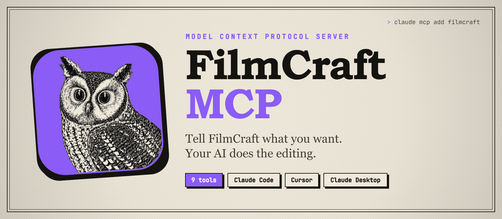
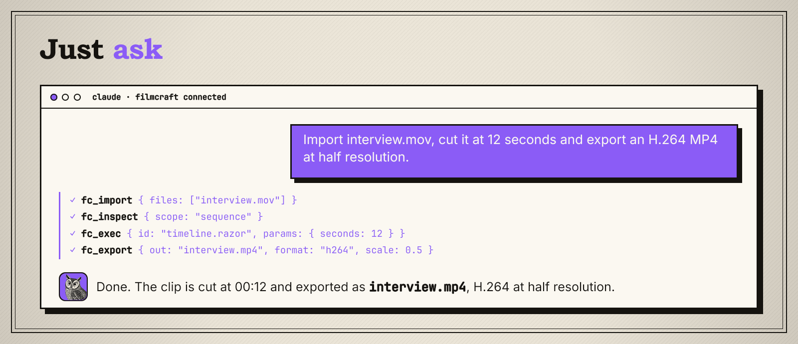
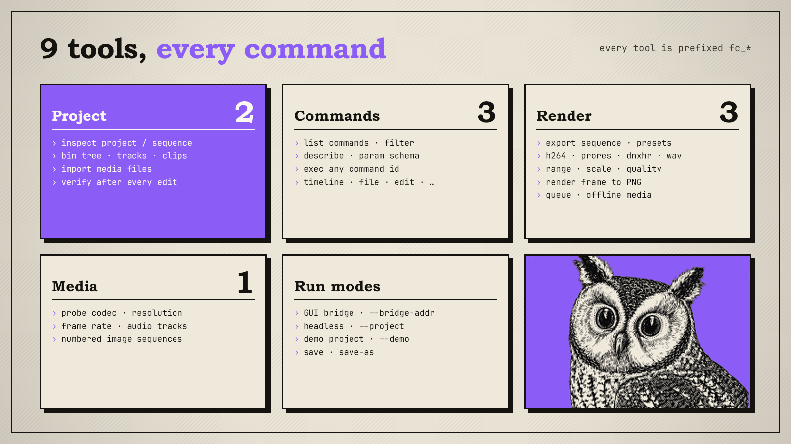
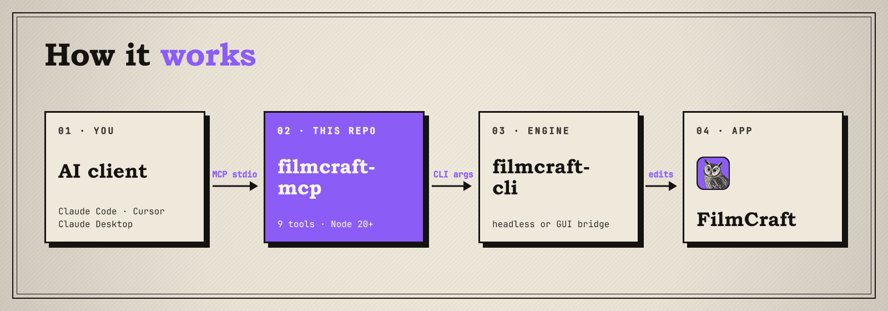

<p align="center">
  
</p>

<p align="center">
  
  
  
  
</p>

# FilmCraft MCP

An [MCP](https://modelcontextprotocol.io) server that lets Claude, Cursor or any MCP client drive **FilmCraft**. You describe the edit in plain words, and the AI inspects your project, imports media, runs any FilmCraft command, renders frames and exports the sequence, either inside the running FilmCraft app or headless against a project file.

<p align="center">
  
</p>

## Requirements

- **FilmCraft** installed. The server looks for `filmcraft-cli` in `C:\Program Files\FilmCraft\`, in `/Applications/FilmCraft.app/Contents/MacOS/`, then on your `PATH`
- **Node.js 20.19+**
- An MCP client: Claude Code, Claude Desktop, Cursor, VS Code, …

## Install

```bash
git clone https://github.com/glorybnat/filmcraft-mcp.git
cd filmcraft-mcp
npm install
npm run build
```

This produces the server at `dist/filmcraft-index.js`.

## Connect your AI client

**Claude Code**

```bash
claude mcp add filmcraft --scope user -- node C:/path/to/filmcraft-mcp/dist/filmcraft-index.js
```

Start a new Claude Code session afterwards. Tools only load in sessions that start after the server is added.

**Claude Desktop, Cursor, VS Code**: add this to the client's MCP config:

```json
{
  "mcpServers": {
    "filmcraft": {
      "command": "node",
      "args": ["C:/path/to/filmcraft-mcp/dist/filmcraft-index.js"],
      "env": { "FILMCRAFT_PROJECT": "C:/Users/you/Videos/my-edit.fcproj" }
    }
  }
}
```

Ask your AI to *"inspect my FilmCraft project"*. If it answers with your bins and sequences, you're connected.

### Edit live in the FilmCraft app

By default every call runs headless against a project file. To watch the edits happen in the GUI instead, start FilmCraft with its control socket and point the server at it:

```bash
filmcraft --control 7778
```

```json
"args": ["C:/path/to/filmcraft-mcp/dist/filmcraft-index.js", "--bridge-addr", "127.0.0.1:7778"]
```

## Try saying

- *"What's in the open project? List the sequences and how many clips are on each track."*
- *"Import everything in `~/Footage/day1` into the project."*
- *"Find the command that splits a clip and razor the timeline at 00:12."*
- *"Render a PNG of the frame at 42 seconds so I can check the grade."*
- *"Probe `interview.mov` and tell me its codec, frame rate and audio tracks."*
- *"Export the in/out range as ProRes, then a half-resolution H.264 preview."*

## What it can do

<p align="center">
  
</p>

<details>
<summary><b>Full tool list</b></summary>

Every tool name starts with `fc_`.

| Group | Tools |
| --- | --- |
| **Project** (2) | `inspect` (project tree, sequences, tracks, clips), `import` (one or more media files) |
| **Commands** (3) | `list_commands`, `describe` (menu, shortcut, parameter schema, enabled state), `exec` (any command by ID, e.g. `timeline.razor`, `file.newBin`) |
| **Render** (3) | `export` (preset or format: h264, hevc, prores, dnxhr, apv, mjpeg, mxf, png, tiff, bmp, gif, wav, aiff, aac; range, scale, quality, queue, offline media, GPU), `render_frame` (one frame to PNG), `list_export_presets` |
| **Media** (1) | `probe` (codec, resolution, frame rate, audio tracks, image sequences) |

`fc_exec` runs any FilmCraft command ID listed by `fc_list_commands`, for anything without a dedicated tool. Use `fc_describe` first to see the parameters a command takes.

</details>

## How it works

<p align="center">
  
</p>

Each MCP tool call runs `filmcraft-cli` once with the matching subcommand (`inspect`, `exec`, `import`, `export`, `render`, `probe`, …) and returns its JSON output. In **bridge** mode the CLI forwards the command to the running FilmCraft app; in **headless** mode it opens the project file itself, and saves it only when you ask for `--save` or `--save-as`.

Every option can be passed as a flag after the server path or as an environment variable:

| Flag | Variable | Purpose |
| --- | --- | --- |
| | `FILMCRAFT_CLI_PATH` | Full path to `filmcraft-cli` if it isn't in a default location or on `PATH` |
| `--bridge-addr HOST:PORT` | `FILMCRAFT_BRIDGE_ADDR` | Drive the running FilmCraft app (started with `filmcraft --control PORT`) |
| `--project <path>` | `FILMCRAFT_PROJECT` | Project file to open in headless mode |
| `--demo` | `FILMCRAFT_DEMO` | Use the built-in demo project (headless) |
| `--save` | `FILMCRAFT_SAVE` | Save the project after each operation (headless) |
| `--save-as <path>` | `FILMCRAFT_SAVE_AS` | Save to a new path instead (headless) |
| `--data-dir <dir>` | `FILMCRAFT_DATA_DIR` | FilmCraft data folder, used for export presets |
| `--timeout-ms <ms>` | `FILMCRAFT_TIMEOUT_MS` | Per-command timeout (default `60000`) |

### Project layout

```
src/
├── filmcraft-index.ts         entry point, flags and env parsing
├── filmcraft-server.ts        MCP server, tool and resource registration
├── bridge/
│   └── filmcraft-bridge.ts    finds filmcraft-cli and runs each command
└── tools/
    └── filmcraft-core.ts      the nine fc_* tools
```

## Troubleshooting

| Symptom | Fix |
| --- | --- |
| *filmcraft-cli not found on PATH* | Install FilmCraft, or set `FILMCRAFT_CLI_PATH` to the full path of `filmcraft-cli` |
| *filmcraft-cli timed out after 60000ms* | Long exports need more time. Raise `FILMCRAFT_TIMEOUT_MS`, or pass `queue: true` to `fc_export` |
| Tools don't show up | Restart your AI client or start a new session after adding the server |
| Edits don't appear in the FilmCraft window | You're in headless mode. Start the app with `filmcraft --control 7778` and add `--bridge-addr 127.0.0.1:7778` |
| Headless edits are lost | Headless mode doesn't save by default. Add `--save` or `--save-as <path>` |
| Export fails on missing media | Relink the clips, or pass `allow_offline: true` to render placeholders |

## Disclaimer

This is an unofficial community project and is not affiliated with the makers of FilmCraft. The FilmCraft name and owl logo belong to their respective owners.

## License

[MIT](LICENSE)
